# Slopshop

Slopshop is a Next.js app for reviewing AI summaries: a filterable, grouped
table by date range with a streamed AI digest, a full-screen report for each
summary, topic discovery as a ranked list and as a clustered graph, and an AI
search over documents, images and videos by meaning. It is a client-side app
that calls its Go API, [summary-api](https://github.com/sri-0/summary-api),
directly.

```bash
pnpm install
cp .env.example .env.local      # NEXT_PUBLIC_API_URL=http://localhost:8002
pnpm dev                        # http://localhost:3100
```

[AGENTS.md](AGENTS.md) describes the structure, the API it calls, the URL
state and the conventions.

## Screenshots

Taken against the seeded local stack; every one is in `docs/`.

| | |
|---|---|
| **AI Summaries**: the filter rail, the streamed digest and the grouped table ([light](docs/summaries-light.png)) | 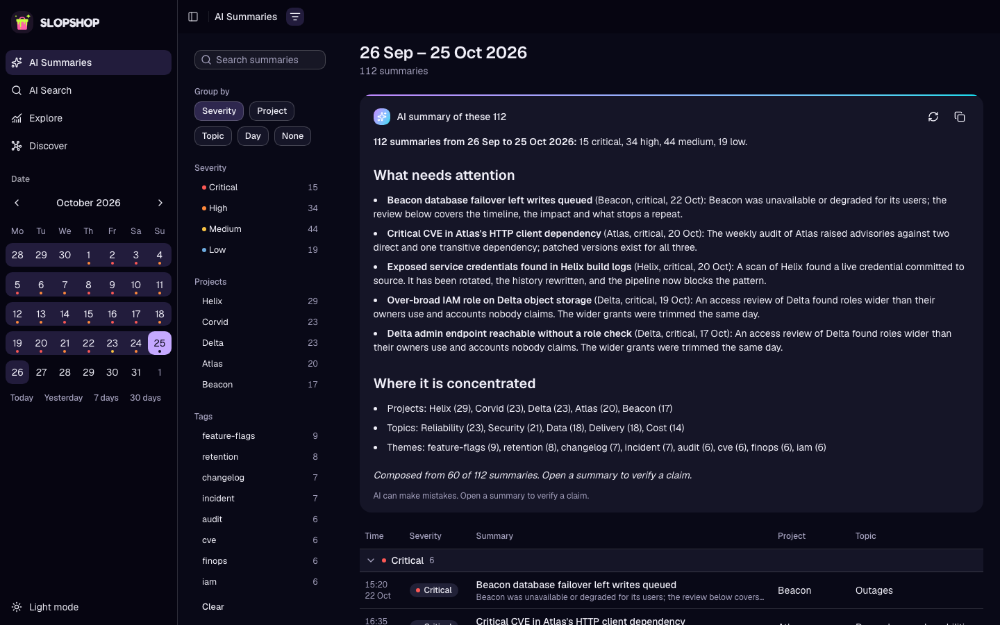 |
| **Filtered**: severity and project applied, grouped by project | 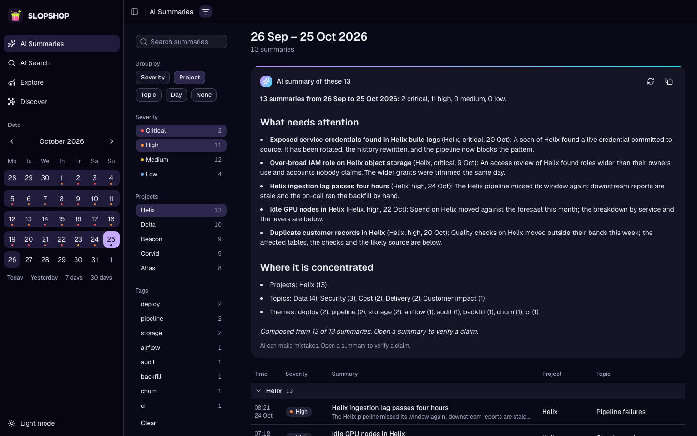 |
| **A report**: the full-screen view with Share link and Copy markdown | 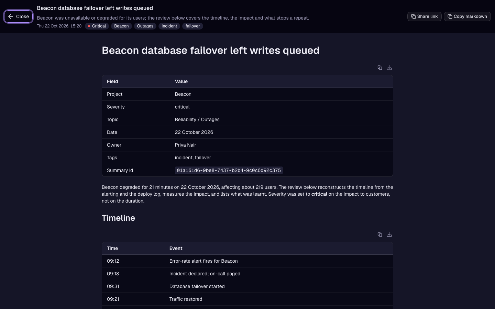 |
| **Share link**: the same report at its own route, led by the brand | 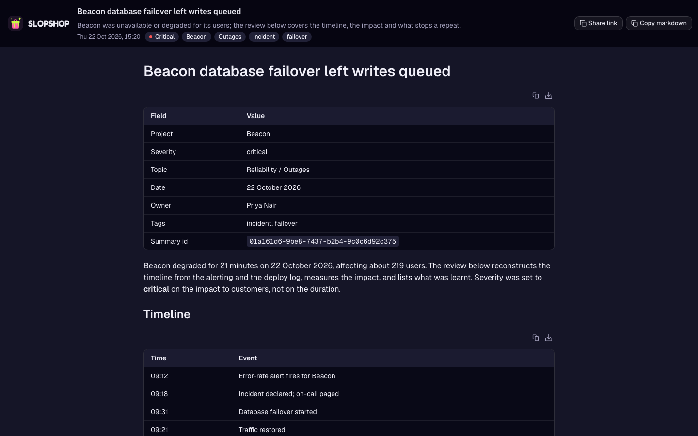 |
| **AI Search**: suggested searches, kind counts, filters and the tag cloud | 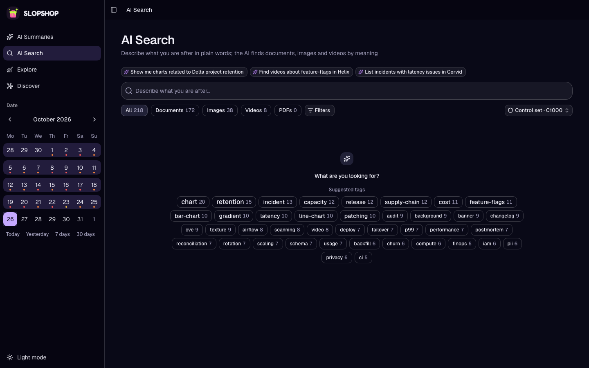 |
| **Results**: cards with scores, Load more and the end mark | 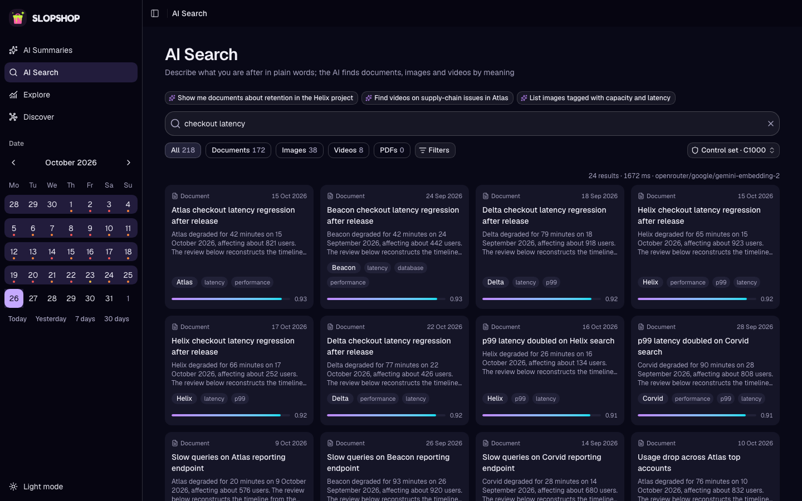 |
| **A document**: an image served from the bucket, with Open summary | 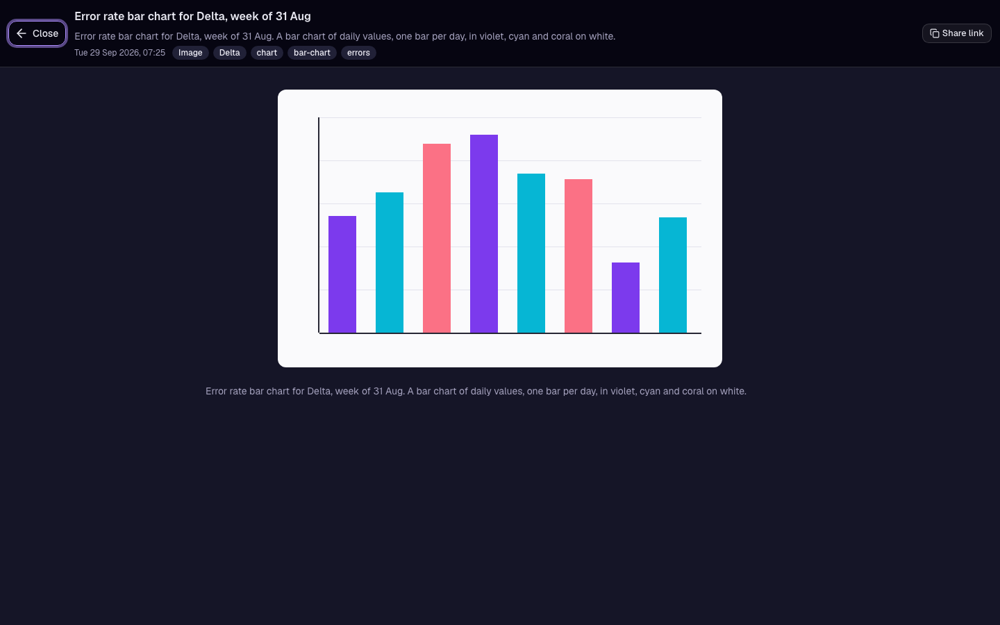 |
| **Explore**: ranked topics with the trend ([cards](docs/explore-cards.png), [one topic](docs/explore-topic.png)) | 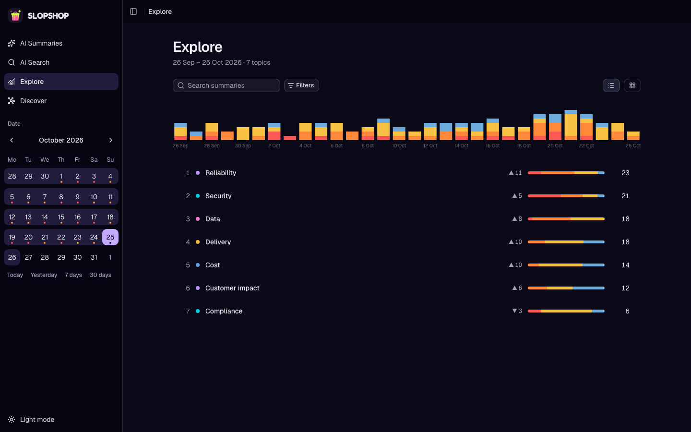 |
| **Filters**: the popover with Apply and Clear, on Explore | 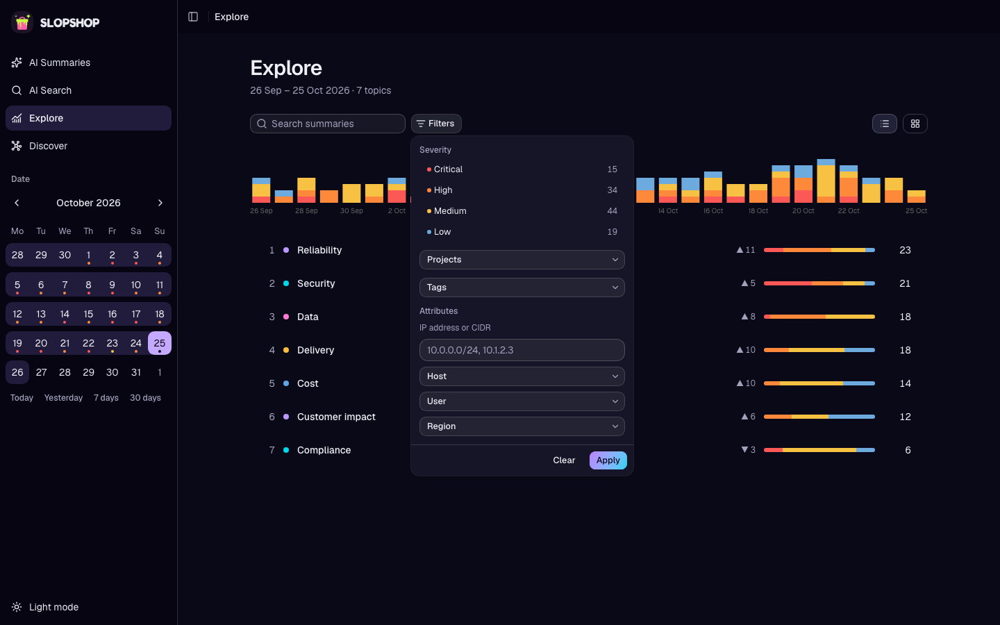 |
| **Discover**: topics in clusters, tags beside them, a topic's panel ([a tag, light](docs/discover-tag-light.png)) | 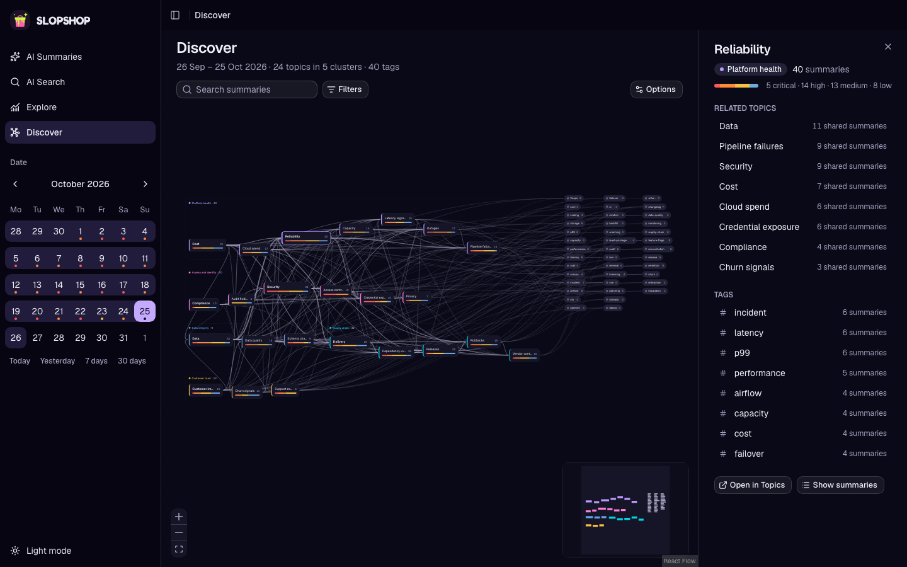 |
| **Discover options**: what the canvas draws | 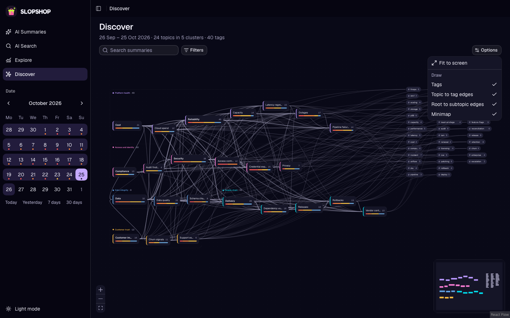 |
